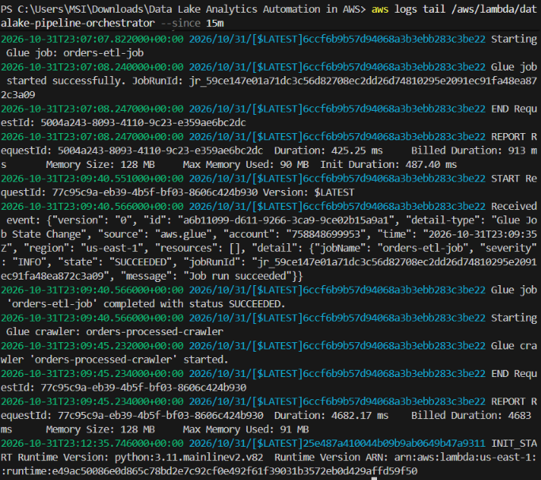
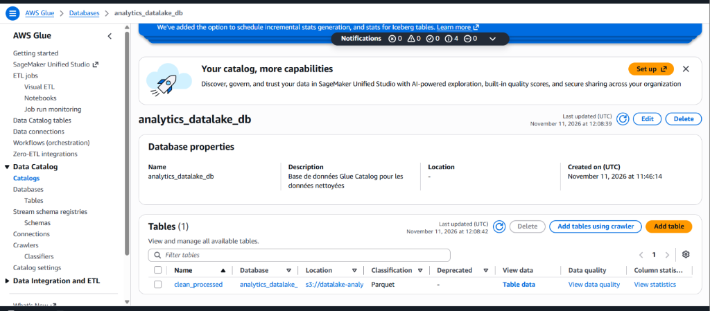
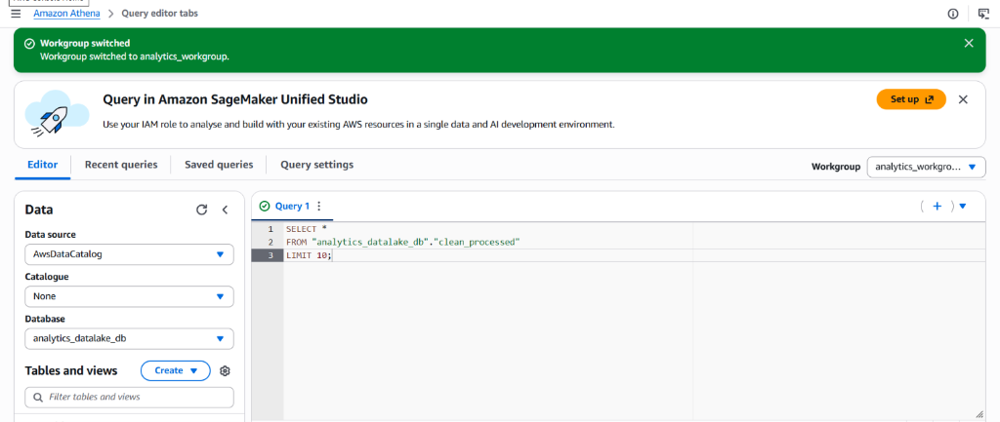
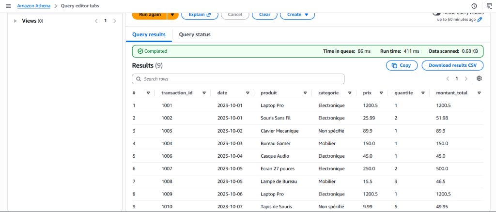
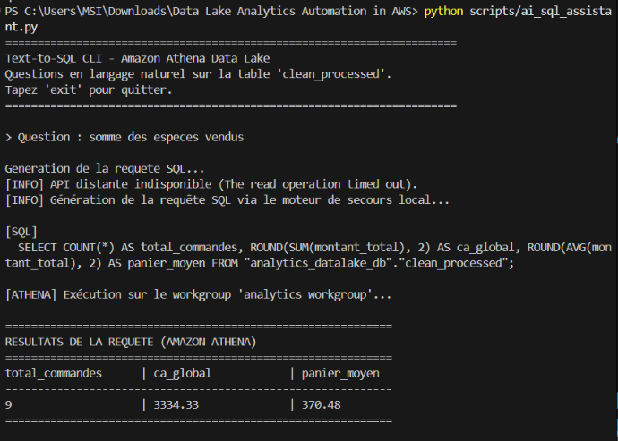

# Automated Data Lake Analytics on AWS

[](https://aws.amazon.com/)
[](https://www.terraform.io/)
[](https://www.python.org/)

## 1. Description du Projet

Ce projet implémente un **Data Lake Analytique Serverless et Événementiel sur Amazon Web Services (AWS)**, entièrement automatisé via **Terraform (Infrastructure as Code)**.

Le pipeline permet d'ingérer automatiquement des flux de transactions e-commerce au format CSV dès leur dépôt sur Amazon S3. Cet upload déclenche une fonction **AWS Lambda** qui orchestre un traitement distribué avec **AWS Glue (PySpark)** pour assainir, valider et convertir les données au format colonnaire optimisé (**Apache Parquet** partitionné). 

Une fois le traitement terminé, **Amazon EventBridge** capture la fin du job Glue et invoque à nouveau la fonction Lambda pour démarrer un **Glue Crawler**. Celui-ci met à jour le schéma dans **AWS Glue Data Catalog**, rendant les données immédiatement requêtables via **Amazon Athena** en SQL ou au travers d'une interface d'interrogation en langage naturel (Text-to-SQL).

---

## 2. Architecture Technique et Flux de Données

```
  [ Source de données ]
  orders.csv (Fichier brut avec anomalies)
       │
       ▼ (aws s3 cp)
┌────────────────────────────────────────────────────────┐
│ Amazon S3 : Bucket Data Lake                          │
│                                                        │
│  ├── raw/                  <── Fichiers CSV d'origine  │
│  │    │                                                │
│  │    ▼ (S3 Event: ObjectCreated)                      │
│  │  ┌─────────────────────────┐                        │
│  │  │ AWS Lambda Orchestrator │                        │
│  │  └───────────┬─────────────┘                        │
│  │              │ (start_job_run)                      │
│  │              ▼                                      │
│  │  ┌─────────────────────────┐                        │
│  │  │   AWS Glue ETL (Spark)  │                        │
│  │  └───────────┬─────────────┘                        │
│  │              │                                      │
│  │              ▼                                      │
│  ├── processed/ ◄── Fichiers Parquet partitionnés      │
│  │                                                     │
│  │  (EventBridge : Glue Job State Change - SUCCEEDED)  │
│  │              │                                      │
│  │              ▼                                      │
│  │  ┌─────────────────────────┐                        │
│  │  │   AWS Glue Crawler      │                        │
│  │  └───────────┬─────────────┘                        │
│  │              │                                      │
│  │              ▼                                      │
│  │  ┌─────────────────────────┐                        │
│  │  │   Glue Data Catalog     │                        │
│  │  │  (Table clean_processed)│                        │
│  │  └───────────┬─────────────┘                        │
│  │              │                                      │
│  └── athena-results/                                   │
│      Résultats requêtes ◄── Amazon Athena              │
│                             (Moteur SQL Serverless)    │
│                                      ▲                 │
│                                      │                 │
│                             Interface Text-to-SQL      │
└────────────────────────────────────────────────────────┘
```

---

## 3. Services AWS Mobilisés

| Service | Rôle dans l'architecture |
| :--- | :--- |
| **Amazon S3** | Stockage objet scalable, sécurisé et centralisé, organisé en trois zones logiques (`raw/`, `processed/`, `athena-results/`). |
| **AWS Lambda** | Orchestrateur serverless exécutant le routage événementiel (déclenchement du job ETL à l'upload S3, puis déclenchement du Crawler via EventBridge). |
| **Amazon EventBridge** | Bus d'événements capturant le changement d'état du job Glue (`SUCCEEDED`) pour automatiser le cycle de vie sans scrutation active. |
| **AWS Glue (ETL PySpark)** | Moteur de calcul distribué exécutant les transformations de données : filtrage des anomalies, calcul des totaux et écriture en Parquet avec compression Snappy. |
| **AWS Glue Data Catalog** | Métastore centralisé stockant les définitions de tables, les schémas et les métadonnées de partitionnement. |
| **AWS Glue Crawler** | Découverte automatique du schéma Parquet et synchronisation de la table `clean_processed`. |
| **Amazon Athena** | Moteur de requêtes SQL serverless interactif interrogeant directement les données stockées dans S3. |
| **AWS CloudWatch** | Centralisation des journaux d'exécution (logs Lambda et Glue) et alarmes sur erreurs. |
| **Amazon SNS** | Notification immédiate par e-mail en cas d'échec du job Glue ou d'erreurs sur la fonction Lambda. |

---

## 4. Règles de Gestion et Transformation (ETL PySpark)

Le dataset source (`data/orders.csv`) contient des cas d'anomalies réelles traités par le script `scripts/glue_etl.py` :

| Donnée brute reçue | Règle de transformation appliquée | Donnée finale dans le Data Lake |
| :--- | :--- | :--- |
| **Transaction_ID dupliqué ou null** | Déduplication et exclusion des identifiants nuls | Unicité stricte garantie |
| **Prix négatif, nul ou invalide** | Filtrage numérique strict (`prix > 0`) | Ligne rejetée du reporting |
| **Catégorie absente ou vide** | Remplacement de la valeur manquante | Normalisé en `'Non spécifié'` |
| **Quantité absente ou 'NULL'** | Imputation par défaut d'une commande unitaire | Quantité fixée à `1` |
| **Métrique métier (CA)** | Calcul dérivé : `montant_total = round(prix * quantite, 2)` | Nouvelle colonne analytique |
| **Format de sortie** | Conversion du format textuel CSV vers Apache Parquet | Partitionnement par catégorie |

---

## 5. Structure du Répertoire

```
.
├── .gitignore                    # Exclusion des fichiers temporaires et sauvegardes Terraform
├── .env.example                  # Template des variables d'environnement (AWS & API)
├── requirements.txt              # Dépendances Python pour l'exécution locale
├── README.md                     # Documentation technique complète
├── providers.tf                  # Configuration des providers Terraform (AWS, Random, Archive)
├── main.tf                       # Création et orchestration du bucket S3 du Data Lake
├── glue.tf                       # Configuration du Job PySpark Glue et du script ETL
├── athena_catalog.tf             # Glue Database, Crawler et Workgroup Athena
├── automation.tf                 # Orchestration Lambda, événements S3 et règles EventBridge
├── monitoring.tf                 # Observabilité (CloudWatch Alarms, EventBridge Target, SNS)
├── data/
│   └── orders.csv                # Jeu de données de test avec cas limites
├── docs/
│   └── screenshots/              # Preuves visuelles d'exécution sur AWS
└── scripts/
    ├── glue_etl.py               # Script distribué PySpark pour AWS Glue
    ├── lambda_trigger.py         # Code de l'orchestrateur événementiel Lambda
    ├── local_etl_test.py         # Tests unitaires locaux validant les règles de nettoyage
    ├── analytics_queries.sql     # Requêtes SQL de référence pour Athena
    └── ai_sql_assistant.py       # Interface Text-to-SQL en ligne de commande
```

---

## 6. Déploiement et Exécution

### Prérequis
* [Terraform](https://developer.hashicorp.com/terraform/downloads) (>= 1.4)
* [AWS CLI v2](https://aws.amazon.com/cli/) avec profil ou variables configurées
* Python 3.10+

### Étape 1 : Validation locale des règles de transformation
```powershell
pip install -r requirements.txt
pytest scripts/local_etl_test.py
```

### Étape 2 : Provisionnement de l'infrastructure avec Terraform
```powershell
terraform init
terraform validate
terraform apply -auto-approve
```

### Étape 3 : Ingestion des données dans le Data Lake
Le dépôt d'un fichier CSV dans le préfixe `raw/` réveille automatiquement la fonction Lambda :
```powershell
$bucket = terraform output -raw s3_bucket_name
aws s3 cp .\data\orders.csv s3://$bucket/raw/orders.csv
```

---

## 7. Résultats et Preuves d'Exécution sur AWS

Toutes les étapes du pipeline ont été validées en conditions réelles sur AWS.

### 7.1 Orchestration Événementielle (AWS Lambda & EventBridge)
La fonction Lambda capture l'upload S3, démarre le job Glue, puis capture la fin de traitement via EventBridge pour lancer le Crawler :



### 7.2 Catalogage des Métadonnées (AWS Glue Data Catalog)
Le Crawler a analysé les fichiers Parquet générés et a créé la table `clean_processed` avec son typage strict :



### 7.3 Configuration du Workgroup Amazon Athena
Le Workgroup dédié `analytics_workgroup` isole l'espace de requête et enregistre automatiquement les sorties sur S3 :



### 7.4 Résultats des Requêtes SQL (Amazon Athena)
Exécution de la requête de sélection sur les données nettoyées. Le moteur n'a scanné que 0.68 KB de données Parquet et a retourné les 9 transactions valides en 411 ms :



### 7.5 Interface d'Interrogation Text-to-SQL
Traduction en temps réel d'une question en langage naturel vers une requête SQL agrégée, exécutée en direct sur Amazon Athena :



---

## 8. Requêtes Analytiques Types (Amazon Athena)

Les requêtes suivantes sont enregistrées dans le workgroup Athena pour l'analyse des ventes :

### 1. Indicateurs Clés de Performance (KPIs Globaux)
```sql
SELECT 
    COUNT(*) AS total_commandes,
    ROUND(SUM(montant_total), 2) AS chiffre_affaires_global,
    ROUND(AVG(montant_total), 2) AS panier_moyen,
    ROUND(MIN(montant_total), 2) AS commande_min,
    ROUND(MAX(montant_total), 2) AS commande_max
FROM "analytics_datalake_db"."clean_processed";
```

### 2. Répartition du Chiffre d'Affaires par Catégorie
```sql
SELECT 
    categorie,
    COUNT(*) AS nombre_transactions,
    ROUND(SUM(montant_total), 2) AS ca_categorie,
    ROUND(AVG(montant_total), 2) AS panier_moyen_categorie
FROM "analytics_datalake_db"."clean_processed"
GROUP BY categorie
ORDER BY ca_categorie DESC;
```

---

## 9. Sécurité et Gestion des Coûts (FinOps)

* **Architecture Serverless** : Aucune ressource allouée en continu. Facturation strictement à l'usage (durée d'exécution Lambda, DPUs Glue consommés, volume scanné par Athena).
* **Format Parquet & Compression Snappy** : Réduction de plus de 80 % de la taille sur disque par rapport au CSV et division des coûts de requêtage Athena (facturé au volume scanné).
* **Protection S3** : Propriété des objets forcée (`BucketOwnerEnforced`) et accès public bloqué.
* **Garde-fous d'exécution Glue** : 2 workers `G.1X`, 0 tentative automatique en cas d'erreur (`max_retries = 0`) et timeout plafonné à 5 minutes pour éviter toute dérive de coût.

---

## 10. Perspectives d'Évolution et Améliorations Futures

Pour faire évoluer ce Data Lake vers une architecture d'entreprise à plus grande échelle, trois axes majeurs sont identifiés :

### 1. Intégration d'un framework de Data Quality et Data Contracts (AWS Deequ / Great Expectations)
* **Objectif** : Valider rigoureusement la conformité des schémas et des règles métier en amont de la zone de consommation.
* **Mise en œuvre** : Implémenter des contrôles automatisés (complétude, plages de valeurs, contraintes d'unicité) directement dans le job PySpark via la bibliothèque open source **AWS Deequ** ou **Great Expectations**.
* **Bénéfice** : Routage automatique des enregistrements non conformes vers une zone de quarantaine (`s3://.../quarantine/`) avec alerte SNS, évitant la pollution du Data Lake sans interrompre le pipeline global.

### 2. Transition vers une architecture Lakehouse avec Apache Iceberg
* **Objectif** : Dépasser les contraintes du stockage Parquet traditionnel en adoptant un format de table ouvert et transactionnel.
* **Mise en œuvre** : Configurer AWS Glue et Amazon Athena pour utiliser le format de table **Apache Iceberg**, nativement supporté par Glue 4.0.
* **Bénéfice** : Prise en charge des transactions ACID, mutations conformes RGPD (mises à jour et suppressions ciblées sans réécriture complète), fonctionnalités de *Time Travel* pour l'audit historique, et élimination du besoin de Crawler grâce aux métadonnées intégrées d'Iceberg.

### 3. Visualisation Décisionnelle et Tableaux de Bord Automatisés (Amazon QuickSight / Apache Superset)
* **Objectif** : Fournir une couche de restitution visuelle et interactive accessible directement aux équipes métiers.
* **Mise en œuvre** : Connecter Amazon Athena à **Amazon QuickSight** (avec moteur de calcul en mémoire SPICE) ou déployer **Apache Superset** connecté au workgroup dédié.
* **Bénéfice** : Rafraîchissement automatique des tableaux de bord financiers et opérationnels (suivi du chiffre d'affaires, panier moyen par catégorie, volumes de ventes) à chaque nouvel arrivage de données.

### 4. Ingestion Universelle Multi-Domaines par Agent Intelligent (Architecture Data Mesh)
* **Objectif** : Remplacer la multiplication de scripts ETL spécifiques (un script par département : Finance, RH, Ventes, Logistique) par un point d'entrée unique et intelligent.
* **Mise en œuvre** : Déployer un agent d'ingénierie de données en amont du calcul distribué. À chaque dépôt d'un fichier non identifié dans la zone d'atterrissage (`raw/`), l'agent inspecte les en-têtes et la distribution sémantique d'un échantillon pour classifier automatiquement le domaine métier (Finance, RH, Ventes), sélectionner ou générer à la volée le plan de transformation PySpark correspondant, et router les données vers les partitions et bases de données cibles appropriées dans Glue Data Catalog.
* **Bénéfice** : Onboarding instantané de nouvelles sources de données sans intervention humaine, élimination de dizaines de scripts redondants à maintenir, et transition naturelle vers une gouvernance décentralisée de type *Data Mesh*.

---

## 11. Suppression des Ressources

Pour supprimer l'ensemble des composants AWS sans laisser de ressources orphelines :

```powershell
terraform destroy -auto-approve
```
