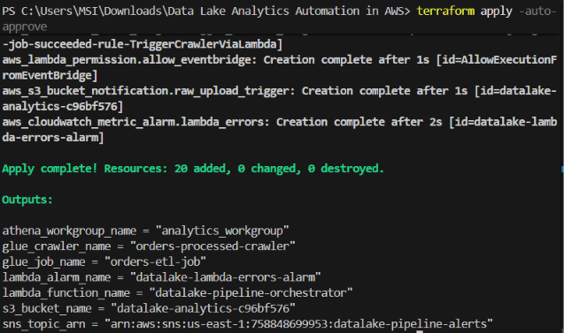
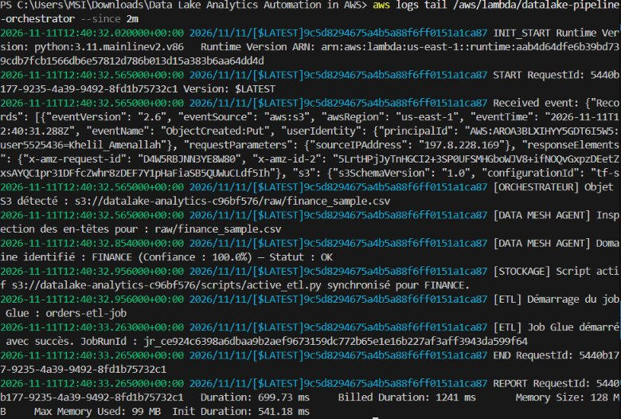
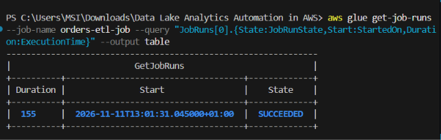
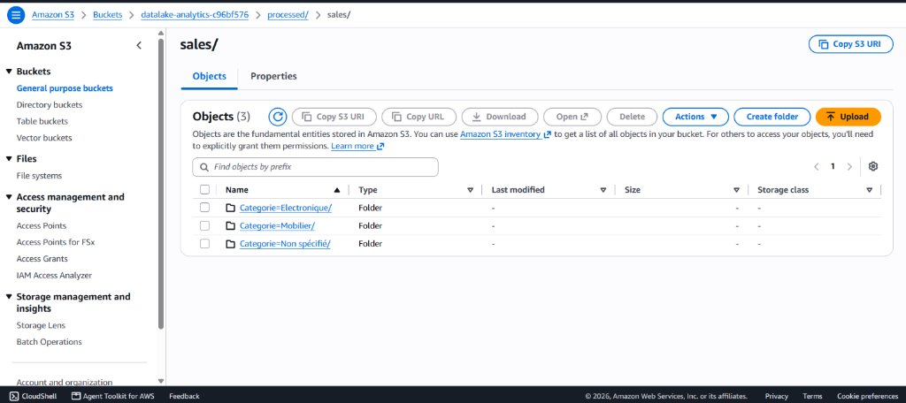
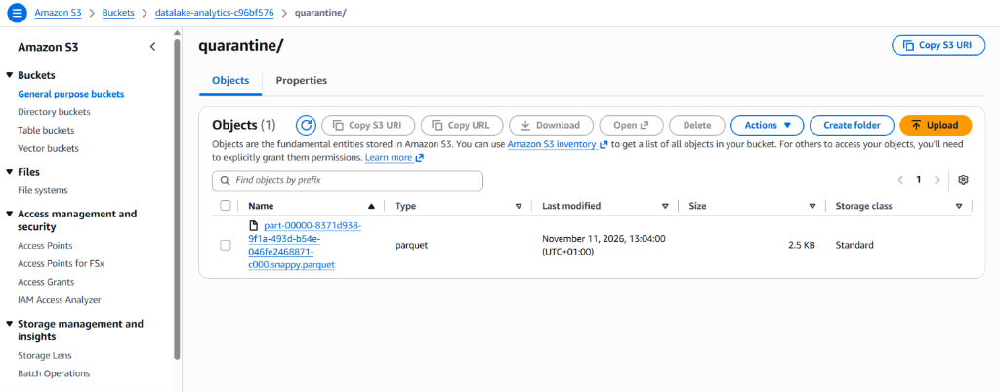
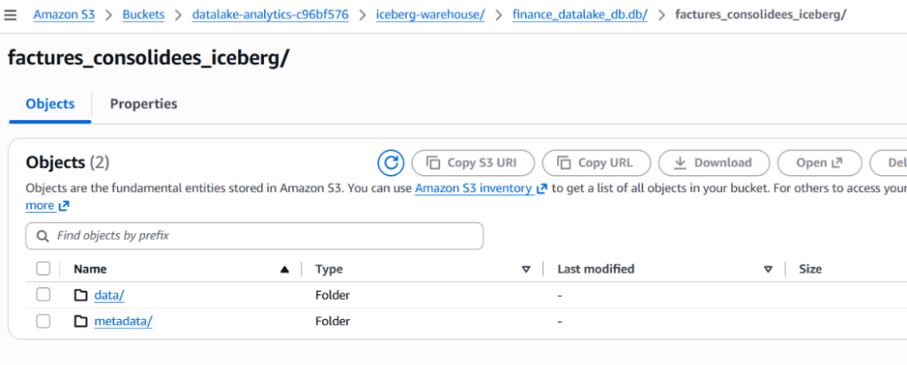

# Automated Data Lake Analytics on AWS

Ce projet implémente un Data Lake analytique serverless sur Amazon Web Services (AWS), déployé avec Terraform et piloté par des événements S3 et EventBridge.

Le pipeline prend en charge l'ingestion automatique de données multi-domaines (Ventes, Finance, Ressources Humaines) au format CSV. Dès qu'un fichier est déposé sur Amazon S3, une fonction AWS Lambda analyse les en-têtes du fichier, détermine le schéma métier correspondant, génère le script PySpark approprié et déclenche le traitement distribué sur AWS Glue.

Le job Glue assure le nettoyage des données, l'application des règles de gestion, l'isolation des rejets dans une zone de quarantaine, et la persistance sous deux formats :
1. **Apache Parquet partitionné** pour les requêtes analytiques standards.
2. **Apache Iceberg** pour la gestion de tables transactionnelles (support ACID et Time-Travel).

À la fin du traitement, Amazon EventBridge déclenche automatiquement le Glue Crawler afin de mettre à jour le catalogue de métadonnées. Les données sont ensuite interrogeables via Amazon Athena en SQL standard ou via une interface Text-to-SQL.

---

## Architecture

```
  [ Fichiers sources multi-domaines ]
  (orders.csv, finance_sample.csv, hr_sample.csv)
       │
       ▼ (aws s3 cp)
┌────────────────────────────────────────────────────────────────────────┐
│ Amazon S3                                                              │
│                                                                        │
│  ├── raw/                  <── Dépôt des fichiers sources              │
│  │    │                                                                │
│  │    ▼ (S3 Event: ObjectCreated)                                      │
│  │  ┌───────────────────────────────────────────────────────────────┐  │
│  │  │ AWS Lambda (Orchestration & Gouvernance)                      │  │
│  │  │  1. Lecture des en-têtes (Range S3 de 4 KB)                   │  │
│  │  │  2. Identification du domaine & score de confiance            │  │
│  │  │  3. Validation : intervention requise si confiance < 60 %     │  │
│  │  │  4. Écriture du script s3://.../scripts/active_etl.py         │  │
│  │  └───────────────────────────────┬───────────────────────────────┘  │
│  │                                  │ (start_job_run --SOURCE_KEY)     │
│  │                                  ▼                                  │
│  │  ┌───────────────────────────────────────────────────────────────┐  │
│  │  │ AWS Glue ETL Job (PySpark)                                    │  │
│  │  └───────┬───────────────────────┬───────────────────────┬───────┘  │
│  │          │                       │                       │          │
│  │          ▼                       ▼                       ▼          │
│  │   quarantine/               processed/            iceberg-warehouse/│
│  │   (Rejets Parquet)         (Parquet partitionné) (Tables Iceberg)   │
│  │                                  │                                  │
│  │  (EventBridge : Glue Job State Change - SUCCEEDED)                  │
│  │              │                                                      │
│  │              ▼                                                      │
│  │  ┌─────────────────────────┐                                        │
│  │  │ AWS Glue Crawler        │                                        │
│  │  └───────────┬─────────────┘                                        │
│  │              │                                                      │
│  │              ▼                                                      │
│  │  ┌─────────────────────────┐                                        │
│  │  │ Glue Data Catalog       │                                        │
│  │  │ - analytics_datalake_db │                                        │
│  │  │ - finance_datalake_db   │                                        │
│  │  │ - hr_datalake_db        │                                        │
│  │  └───────────┬─────────────┘                                        │
│  │              │                                                      │
│  └── athena-results/                                                   │
│      Sortie des requêtes ◄── Amazon Athena                             │
│                              (Requêtage SQL serverless)                │
└────────────────────────────────────────────────────────────────────────┘
```

---

## Services AWS utilisés

| Service | Usage dans le projet |
| :--- | :--- |
| **Amazon S3** | Stockage objet centralisé (`raw/`, `processed/`, `quarantine/`, `iceberg-warehouse/`, `athena-results/`). |
| **AWS Lambda** | Analyse des en-têtes, classification de domaine, génération du script PySpark et lancement des jobs. |
| **Amazon EventBridge** | Capture de la fin du job Glue (`SUCCEEDED`) pour démarrer le Crawler de façon asynchrone. |
| **AWS Glue (PySpark)** | Exécution du calcul distribué, validation qualité, partitionnement et écriture Parquet / Iceberg. |
| **AWS Glue Data Catalog** | Référentiel de métadonnées multi-domaines (`analytics_datalake_db`, `finance_datalake_db`, `hr_datalake_db`). |
| **AWS Glue Crawler** | Découverte automatique des partitions et schémas Parquet pour mise à jour du catalogue. |
| **Amazon Athena** | Moteur de requêtes SQL serverless avec workgroup dédié (`analytics_workgroup`). |
| **AWS CloudWatch** | Centralisation des logs d'exécution (Lambda et Glue) et alarme métrique en cas d'erreur. |
| **Amazon SNS** | Envoi d'alertes par e-mail en cas d'échec sur le pipeline. |

---

## Règles de gestion par domaine

Le module de classification applique des règles de validation adaptées à chaque structure de données :

| Domaine | Base de données | Table | Partition | Règles appliquées |
| :--- | :--- | :--- | :--- | :--- |
| **Ventes (SALES_ECOMMERCE)** | `analytics_datalake_db` | `clean_processed` | `Categorie` | Rejet des prix unitaires $\le$ 0 vers `quarantine/`, remplacement des catégories vides par `'Non spécifié'`, calcul du `Montant_Total`. |
| **Finance (FINANCE)** | `finance_datalake_db` | `factures_consolidees` | `Devise` | Contrôle des montants HT (> 0), calcul et validation de la TVA et du montant TTC, synchronisation de la table Iceberg. |
| **Ressources Humaines (HUMAN_RESOURCES)** | `hr_datalake_db` | `collaborateurs_conformes` | `Departement` | Hachage cryptographique SHA-256 des identifiants personnels (`Nom`, `Prenom`, `SSN`), contrôle de validité des salaires. |

---

## Contrôle de validation et seuils de confiance

Le module d'ingestion évalue la correspondance des colonnes détectées par rapport aux schémas de référence :

- **Score $\ge$ 90 % (Statut : OK)** : Ingestion et exécution Glue immédiates sans intervention.
- **Score entre 60 % et 89 % (Statut : WARNING)** : Ingestion automatique avec journalisation d'un avertissement dans CloudWatch pour traçabilité.
- **Score < 60 % (Statut : REVIEW_REQUIRED)** : Blocage du job Glue afin de préserver l'intégrité du Data Lake, archivage du fichier pour analyse.

> **Règle d'exploitation :**  
> L'intervention humaine est requise si et seulement si le score de confiance est inférieur à 60 %.

---

## Structure du projet

```
.
├── .gitignore                    # Fichiers et dossiers exclus du dépôt
├── .env.example                  # Modèle des variables d'environnement
├── requirements.txt              # Dépendances Python pour l'exécution locale
├── README.md                     # Documentation technique du projet
├── providers.tf                  # Configuration des providers Terraform (AWS, Random, Archive)
├── main.tf                       # Création et organisation du bucket S3
├── glue.tf                       # Configuration du Job AWS Glue et dépendances
├── athena_catalog.tf             # Catalogues Glue, Crawler et Workgroup Athena
├── automation.tf                 # Configuration Lambda, rôles IAM et règles EventBridge
├── monitoring.tf                 # Alarme CloudWatch et topic SNS
├── data/
│   ├── orders.csv                # Données de test : Domaine Ventes
│   ├── finance_sample.csv        # Données de test : Domaine Finance
│   └── hr_sample.csv             # Données de test : Domaine RH
├── docs/
│   └── screenshots/              # Captures d'écran des tests sur AWS
└── scripts/
    ├── data_mesh_agent.py        # Module de classification et génération du code PySpark
    ├── lambda_trigger.py         # Code de la fonction Lambda de déclenchement
    ├── local_etl_test.py         # Tests unitaires locaux des transformations et contrôles
    ├── integration_test.py       # Tests d'intégration du pipeline
    ├── iceberg_analytics.sql     # Requêtes DDL et requêtes de Time-Travel Iceberg
    ├── quicksight_spice_manifest.json # Manifest pour ingestion QuickSight SPICE
    ├── analytics_queries.sql     # Requêtes SQL de référence pour Athena
    └── ai_sql_assistant.py       # Utilitaire de requêtage SQL en langage naturel
```

Remarque : Le script `scripts/active_etl.py` est produit dynamiquement lors de l'exécution et téléversé sur S3 (`s3://<bucket>/scripts/active_etl.py`). Il est ignoré par Git via le fichier `.gitignore`.

---

## Guide d'exécution

### 1. Tests locaux préalables

Exécutez la validation locale avant déploiement :

```powershell
# Validation des règles de gestion, du filtrage et des contrôles de sécurité
python scripts/local_etl_test.py

# Validation de l'intégration multi-domaines et des configurations Iceberg
python scripts/integration_test.py
```

### 2. Configuration des accès AWS

Renseignez vos identifiants temporaires dans le fichier `.env` :

```env
AWS_ACCESS_KEY_ID=ASIA...
AWS_SECRET_ACCESS_KEY=...
AWS_SESSION_TOKEN=IQoJb...
AWS_DEFAULT_REGION=us-east-1
```

Chargez les variables dans votre session PowerShell :

```powershell
Get-Content .env | Where-Object { $_ -match '^\s*[^#].*=.*' } | ForEach-Object {
    $parts = $_ -split '=', 2
    [System.Environment]::SetEnvironmentVariable($parts[0].Trim(), $parts[1].Trim(), 'Process')
}

aws sts get-caller-identity
```

### 3. Déploiement Terraform

```powershell
terraform init
terraform apply -auto-approve
```

### 4. Test d'ingestion

Déposez un fichier dans le dossier `raw/` du bucket S3 créé :

```powershell
$bucket = terraform output -raw s3_bucket_name

# Ingestion d'un flux Ventes
aws s3 cp data/orders.csv s3://$bucket/raw/orders.csv

# Ingestion d'un flux Finance
aws s3 cp data/finance_sample.csv s3://$bucket/raw/finance_sample.csv
```

Suivi de l'exécution :

```powershell
# Consultation des logs Lambda
aws logs tail /aws/lambda/datalake-pipeline-orchestrator --since 2m

# Suivi de l'état du Job Glue
aws glue get-job-runs --job-name orders-etl-job --query "JobRuns[0].{State:JobRunState,Duration:ExecutionTime}" --output table
```

### 5. Vérification des résultats

Vérifiez le contenu des dossiers S3 :

```powershell
# Données nettoyées en Parquet
aws s3 ls s3://$bucket/processed/ --recursive

# Rejets isolés en quarantaine
aws s3 ls s3://$bucket/quarantine/ --recursive

# Tables Apache Iceberg
aws s3 ls s3://$bucket/iceberg-warehouse/ --recursive
```

Exécution d'une requête analytique avec Athena :

```powershell
$qid = aws athena start-query-execution `
  --query-string "SELECT COUNT(*) AS total_commandes, ROUND(SUM(montant_total), 2) AS ca_total FROM analytics_datalake_db.clean_processed;" `
  --work-group analytics_workgroup `
  --query "QueryExecutionId" `
  --output text

aws athena get-query-results --query-execution-id $qid --output table
```

### 6. Suppression de l'infrastructure

En fin de session, supprimez l'ensemble des ressources provisionnées :

```powershell
terraform destroy -auto-approve
```

---

## Résultats et captures d'écran

Les captures suivantes illustrent le fonctionnement du pipeline sur l'environnement AWS.

### Déploiement Terraform (`terraform apply`)
Création des 20 ressources serverless et affichage des outputs :



### Configuration de la fonction Lambda
Déclencheurs S3 en entrée et règle EventBridge en sortie :


### Logs d'exécution Lambda (CloudWatch)
Détection du domaine Finance à 100 %, génération du script PySpark et lancement du job Glue en 699 ms :



### État du Job AWS Glue
Exécution réussie du calcul distribué (`SUCCEEDED`) en 155 secondes :



### Organisation des données dans S3
Partitionnement physique par catégorie (`Categorie=Electronique/`, `Mobilier/`, etc.) sous `processed/sales/` :



### Catalogue de métadonnées Glue Data Catalog
Table `clean_processed` découverte par le Crawler dans la base `analytics_datalake_db` :


### Zone de quarantaine S3
Isolation de l'enregistrement rejeté (prix négatif) au format Parquet dans `quarantine/` :



### Structure du Lakehouse Apache Iceberg
Organisation de la table Iceberg dans `iceberg-warehouse/` avec les dossiers `data/` et `metadata/` :



### Workgroup Amazon Athena
Workgroup `analytics_workgroup` configuré pour consigner les résultats dans `athena-results/` :


### Requête SQL dans Amazon Athena
Exécution de la requête de contrôle sur les données nettoyées (9 lignes retournées en 411 ms, 0.68 KB scannés) :


### Interface Text-to-SQL
Génération d'une requête SQL et restitution du résultat à partir d'une consigne formulée en langage naturel :


---

## Optimisation des coûts (FinOps) et sécurité

* **Modèle Serverless** : Aucune ressource n'est allouée en continu. La facturation est liée aux durées d'exécution Lambda, aux DPUs consommés par Glue et au volume scanné par Athena.
* **Format Parquet & Compression Snappy** : Réduction du volume stocké sur S3 et diminution des coûts de requêtage Athena par rapport au format CSV brut.
* **Sécurité S3** : Propriété des objets forcée (`BucketOwnerEnforced`) et blocage systématique de tout accès public.
* **Paramétrage d'exécution Glue** : Allocation limitée à 2 workers `G.1X`, aucun retry automatique (`max_retries = 0`) et timeout fixé à 5 minutes pour éviter toute dérive de coût.
